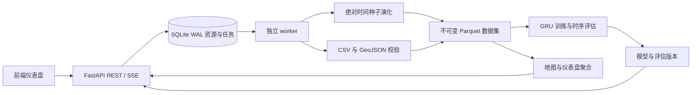

# 后端交接文档

更新日期：2026-11-11（Asia/Shanghai）。系统名RideCast，HTTP版本保持 `/api/v1`，工程版本以pyproject.toml和`/health.version`为准。初版验收标签为v0.1.0；当前为保留旧模型兼容的v2质量升级，`web/`前端仪表盘已接入。

## 运行与环境

Python 3.11/3.12；本次实测为 macOS arm64、Python 3.12。项目依赖精确锁定 TensorFlow 2.19.1、Keras 3.11.3、NumPy 2.1.3、PyArrow 21、FastAPI 0.116.1。TensorFlow 2.20/PyArrow 组合在本机复现原生 mutex 崩溃，采用兼容版本解决，依据见[官方问题记录](https://github.com/tensorflow/tensorflow/issues/98563)。不要单独随意升级该组合。

```bash
python3.12 -m venv .venv
source .venv/bin/activate
pip install -e '.[ml,dev]'
ridecast init
ridecast demo --days 45 --epochs 30 --tune --output reports/current-demo.json
ridecast serve --host 127.0.0.1 --port 8000
```

在第二个同环境终端运行 `ridecast worker`。API 排队任务，worker 执行模拟、导入、训练；仅启动 API 时任务会保留在 queued。`ridecast status` 查看队列、资源数及 worker 在线状态。`ridecast worker --once` 最多执行一个排队任务后退出。`demo` 自带本地 worker 执行整条链路，不需要预先启动服务。

前端从 `web/` 运行 `npm install`、`npm run dev`，默认本地5173端口代理到8000；详情见web/README.md。已有v1资源仍可在仪表盘查看，升级无需清空var或迁移旧模型文件。若有旧API/worker进程，代码更新后应分别重启，避免请求仍落到旧模型实现。

仅需地图/数据/接口时可安装 `pip install -e .`；训练/预测必须加 `[ml]`。`requirements.lock.txt` 保存本次完整依赖快照，可用 `pip install -r requirements.lock.txt` 再安装本项目。Linux 所需额外平台依赖由 pip 解析；直接依赖仍以 pyproject 为准。

## 配置

环境变量须同时传给 API/worker；`.env.example` 只是样例，程序不会隐式读取 `.env`。

| 变量 | 默认值 | 用途 |
| --- | --- | --- |
| RIDECAST_HOME | 当前目录/var | SQLite、世界、数据、模型及临时文件 |
| RIDECAST_API_KEY | 空 | 配置后 `/api/v1` 所有接口要求 `X-API-Key` |
| RIDECAST_CORS_ORIGINS | http://localhost:3000,http://localhost:5173 | 允许的前端来源，以逗号分隔 |

API 默认绑定 127.0.0.1:8000。`/health`、`/docs`、`/openapi.json` 可公开读取；它们不返回 API key。密钥由环境配置，不能嵌入对外公开前端。此版本面向本地课题/单机演示，无多租户权限系统。

## 模块与数据流



| 模块 | 职责 |
| --- | --- |
| simulation.py | 确定性城市、单桶状态、天气/活动/供需演化、订单 |
| data.py | 导入、去重/无效行策略、完整面板、标签聚合一致性、校验和 |
| features.py | 邻域和窗口特征、训练缩放、未来可用上下文、基线 |
| seasonal.py | 严格起点以前的日/周lag、工作/休息日匹配画像和季节先验 |
| ml.py | v2计数残差GRU、验证选择/校准、融合、评估、兼容推理缓存 |
| legacy_features.py / legacy_ml.py | 冻结v1算法和旧特征模型预测，供兼容及等预算对照 |
| dashboard.py | KPI、时序、热力、OD、回放、分页、启发式调配 |
| store.py | SQLite 注册表、原子任务认领、事件、发布事务与失联隔离 |
| worker.py | 任务执行、心跳、合作取消、失败清理 |
| api.py / schemas.py | 版本化 HTTP、上传、校验、鉴权、SSE、学习曲线 |
| cli.py | 本地启动、演示、worker、状态和 OpenAPI 导出 |

## 确定世界与自然演化

城市地图采用 `seeded-city-v2`，演化采用 `absolute-time-v2`。同一世界种子确定地图划分与区域属性；同一世界、运行seed、绝对时间、场景和生成器版本确定天气、需求与供给状态。世界随时间变化，提取重叠历史窗口不会重启随机流；仿真接口和单桶state可访问同一绝对时间轴。HTTP state使用注册世界日程，历史场景覆盖应从对应数据集的heatmap/replay读取。

这是按桶计算的宏观世界，没有后台自动推进的现实时间时钟，也不枚举完整车队连续轨迹。前端控制时间游标；replay明确标记历史回放，车辆位置由已知起终点和时长作直线插值。演化区域 `state` 根据取消数标为 balanced/undersupplied，不能用地图原始 `supply_gap` 替代：后者仅为请求数减司机数的计数差，服务容量还与桶时长和拥堵有关。

## 持久化与模型生命周期

`var/ridecast.sqlite3` 为注册表。`worlds/w_*/world.json` 保存地图；`datasets/d_*/` 含 `panel.parquet`、`orders.parquet`、`world.json`、`manifest.json`；`models/m_*/` 含 `.keras`、元信息、最终/实时学习曲线、测试预测明细。工作中产物位于 `.staging/j_*`；上传文件位于 `uploads/j_*`。失败/取消训练可保留 `jobs/j_*/history.json`。

写完全部文件后才注册资源。模型开发保存数据内容摘要、地图/区域指纹、特征版本、依赖版本、随机种子、时间分区、候选与指标。模型不自动激活；`POST /models/{id}/activate` 显式设置每世界的 active-model 指针。预测请求仍须显式传 model_id，因此既有调用不会因激活而悄悄换模型。可以重新激活旧版本实现回退。预测拒绝地图/区域/时间桶/时区/标签口径不匹配或早于模型开发数据末尾的数据；滚动预测用同世界新导入或新模拟的连续历史数据集。

## v2模型与前端兼容

新训练默认最多30轮、lookback24、horizon3、units32、batch_size128、learning_rate0.001、seed42、loss=poisson。`tune=true`比较相同GRU结构的Poisson/Huber计数损失，而非v1的两种宽度；前端训练表单、loss_unit和模型metadata反映实际配置。推荐请求：

```json
{"dataset_id":"实际d_标识","config":{"epochs":30,"lookback":24,"horizon":3,"units":32,"batch_size":128,"learning_rate":0.001,"seed":42,"loss":"poisson","tune":true}}
```

v2以起点可用的季节画像为先验，共享GRU结合日历谐波、历史活动、区域用途及显式日/周lag，经逐步共享头学习计数残差；默认直接在订单数量上使用Poisson损失，未读取仿真隐藏状态或未来实测外因。日/周lag可读取超过lookback的更早历史，但始终严格早于预测起点。

70/15/15时间分区保留，验证段前65%选epoch、损失候选、基线与融合权重；后35%独立校准残差区间，跨分界多步窗口排除。小数据不能再分时会显式设置 `validation_subsplit.independent_calibration=false`；独立验收的45天数据不允许该回退。详细方法见MODELING.md，最终新结果见待完成的reports/model-quality.md及JSON，不能用下方v1历史分数代替。

`metrics.model`和forecast.rows是实际服务预测；`metrics.neural`及evaluation.neural_demand是纯神经预测。`blending`记录基线名、验证网格、神经权重及部署形式neural/neural_seasonal_blend/seasonal_fallback；权重0即季节回退，不能宣称纯神经胜出。Poisson loss可能为负，Huber和旧log1p-MSE也不是同一量纲，学习曲线读取loss_unit，跨模型效果比较使用MAE/RMSE/WAPE及bias。

新增 `metrics.operational.city/peak/off_peak/high_demand` 供城市总量、高峰/非高峰及高需求误差展示；high_demand阈值来自训练数据需求80%分位数，阈值与分组说明一并归档。旧metrics.model/baseline/by_horizon/by_zone路径保留，前端可逐步增加新卡片。

v1的 `feature_schema.version=origin-aware-v1` 经统一forecast入口自动分派至legacy模型；v2为origin-aware-profile-v3。两类模型保留相同HTTP必需字段，新增元信息以可选字段扩展，不更改旧值语义。旧模型仍可预测、查看和激活；新训练模型不会覆盖旧资源。

预测与调配必须传同一已展示的scenario。`DispatchRequest.scenario`现在透传给与 `/forecasts` 相同的预测函数，返回scenario可核对；前端沿用已完成预测的参数，而非尚未重新预测的表单值。`demand_multiplier`仍是显式模型后缩放假设，不能称为学出的因果效应；如果选中纯季节回退，天气/活动覆盖未必会改变点预测，须看blending解释。

## 任务与故障恢复

状态：`queued → running → succeeded / failed`；queued 取消直接 `cancelled`，运行中取消为 `cancelling`，在下一进度检查点转 cancelled。取消不是强杀训练进程，单轮结束前可能仍在计算。`progress` 为 0–1 且单调；成功才为1。事件保存在 SQLite，API 可重新连接继续读取。

worker 每5秒心跳；超过120秒无心跳的 running/cancelling 任务在 worker 启动或空闲检查时标记 `failed/worker_lost`。终态不会偷偷重置或重复执行；用户重新提交以重试。旧 worker 丢失所有权后不能发布资源，资源注册与成功事件在同一写事务中完成。API 重启不丢排队任务。建议单 worker 串行执行控制 TensorFlow 内存，事务认领避免重复处理；SQLite 不用于跨主机共享网络磁盘。

已取消的排队导入上传立即清理；执行中的导入无论成功/失败均清理上传；普通失败清理 staging。进程被强制终止时可能留下孤立 staging/upload/未注册产物目录：停下相关 worker，备份后对照 SQLite jobs/resources 删除未被任何活动任务引用的目录。此版本不提供自动资源删除，避免删除训练所依赖的版本。备份时停止 API/worker 后整体复制 `RIDECAST_HOME`；只复制 SQLite 文件会丢失模型和数据。

## 资源限制与扩展

HTTP 每文件32MiB；数据集最多150,000个区域时间桶、500,000订单；仿真请求2–180天，桶15/30/60分钟，HTTP新建网格最大8×8；内部函数也有限制。训练按窗口特征数限制内存，超限明确失败；可缩短观测范围/回看长度或减少区域。API 图表分页/上限见 OpenAPI，回放及OD最多展示请求limit条，并提供总数/截断信息。

聚合目前读取单机 Parquet，适合课题规模，不宣称经过高并发/亿级订单压测。资源列表单页最多1,000；timeseries和evaluation最多10,000，其他图表上限见OpenAPI。模型缓存最多2个不可变版本。生产扩展依次考虑预聚合/列式查询、对象存储、PostgreSQL/PostGIS、独立推理服务与 Redis/Celery 队列；扩展时保留相同 dataset/feature schema。

## 验证、交接与 Git

执行 `pytest -q`、`ruff check .`、`pip check`。验证包含确定性/分段演化、真实导入、任务并发认领/丢失隔离、HTTP/SSE、数据泄漏边界和实际 TensorFlow 训练/重载。实测范围与指标见 `reports/VALIDATION.md`、演示报告和多种子报告；Docker/GitHub Actions 配置已提供，但仅在实际运行后才算对应环境验证。

v1历史多世界报告为 `reports/world-benchmark.md` 与同名JSON，原始数据/模型位于 `var/benchmarks/world-holdout/`。这里“v2世界”指城市生成器版本seeded-city-v2，不是升级后的v2预测模型。历史种子7/42/99，每世界28天、9区域、相同5轮v1小模型配置；模型平均MAE为3.4736，基线平均MAE为3.3265，1/3世界模型优于基线。它们已被用于开发参考，不能作为新模型独立验收。新质量协议见MODEL_QUALITY_PROTOCOL.md，冻结后由 `python scripts/evaluate_quality.py --run --output var/quality/final-v1` 生成新报告；未达到预登记目标时如实保留未通过结论。每世界均独立重训，不是单模型跨城市迁移或真实业务精度保证。

远程仓库：[Nivek-Z/RideCast](https://github.com/Nivek-Z/RideCast)。主分支main，初版开发分支codex/ridecast-backend及标签v0.1.0保留，质量升级开发分支为codex/model-quality，基于已合并前端的main推进。初版M0–M4及后续模型/前端/验收提交可用 `git log --oneline --decorate` 查看。Git包含代码、交接文档和小体量合成报告；不包含虚拟环境、私有订单、大体积生成数据或模型，克隆后运行demo重新生成。

当前模型训练新增rate_profile.py（仅训练集拟合正则条件率）和adaptation.py（仅起点前已观察误差的水平校准）。后者不会重训网络或读当前/未来标签；metadata.adaptation及回测adaptation_factor明确公开，旧v1不改变。第一轮未通过研究报告保留，新版验收使用第二轮新种子/时段。

升级实测和当前启用模型见reports/MODEL_UPGRADE_VALIDATION.md；206项回归、68项真实HTTP检查通过。独立第二轮MAE改善9.71%，稳定性及基线比较改善，但自设15%进阶门槛未达；完整布尔失败记录保留，不称全部目标通过。已知演示新模型m_5c91b393189043be仅属于霁川市，不影响其他城市或旧模型版本。
